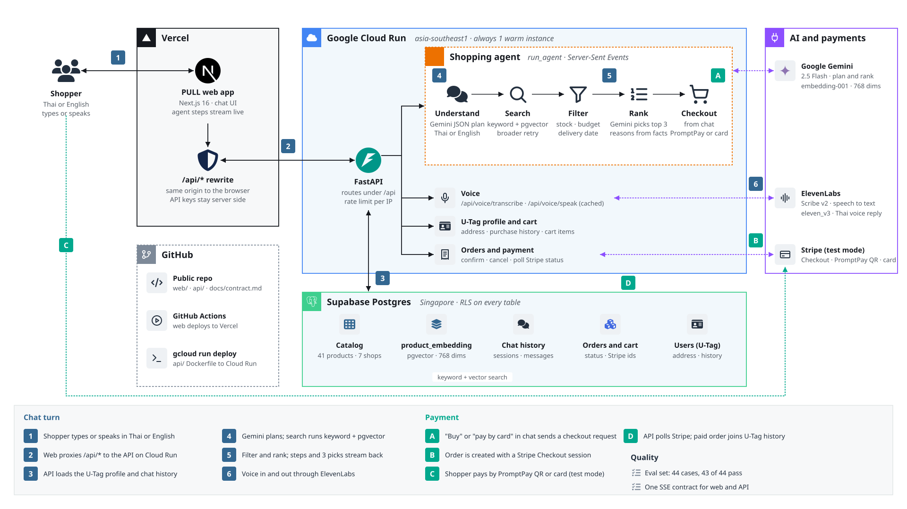

# PULL (Let-Me-Cook)

Say what you need once, in Thai or English, by text or voice. An AI agent searches the shops on the
platform, removes what is out of stock, over budget or too late, ranks what is left, and shows you
the best 3 with a reason for each. Then you pay right in the chat with PromptPay or a card.

U-Hackathon 2026, Track 1 (AI).

**Live demo: https://web-eta-khaki-31.vercel.app**

## Try it

1. Open the demo link. You chat as the demo shopper, whose delivery address and purchase history come from their U-Tag profile.
2. Type or tap the mic and say something like:

   | Try saying | What it shows |
   | --- | --- |
   | `หาเก้าอี้ทำงานงบ 5000 ส่งภายใน 3 วัน` (office chair, budget 5,000 baht, delivered within 3 days) | budget and delivery filters, top 3 with reasons |
   | `ปวดคอเวลาดูจอโน้ตบุ๊ค` (my neck hurts when I look at my laptop) | a problem, not a product name, turned into a search |
   | `I need earbuds for running under 2000 baht` | English replies (product names stay Thai) |
   | `ขอดูทั้งหมด` / `มีแบบอื่นอีกไหม` (show all / anything else?) | up to 12 results, or more results without repeats |
   | `เอาตัวที่ 2` (I'll take number 2) | checkout from the chat |
   | `จ่ายด้วยบัตรแทน` (pay by card instead) | switches the payment method |

3. Pay in Stripe **test mode**:
   - Card: `4242 4242 4242 4242`, any future expiry date, any CVC.
   - PromptPay: the QR shows right in the chat. In test mode it opens Stripe's page to approve or fail the payment, so no bank app is needed.

   No real money moves. The order card in the chat turns to paid on its own, and the item joins
   the shopper's purchase history, so the next recommendation knows about it.

The catalog is demo data: 41 products, 9 categories, 7 shops.

## Architecture



The diagram is a draw.io file: open `docs/architecture.drawio.svg` in [draw.io](https://app.diagrams.net) to edit it.

| Part | What it uses |
| --- | --- |
| Web (`web/`) | Next.js 16, Tailwind, on Vercel. The browser only calls `/api/*`, which the server rewrites to the API, so no keys reach the browser. |
| API (`api/`) | FastAPI on Python 3.13, on Google Cloud Run (asia-southeast1). Chat replies stream as Server-Sent Events, so the shopper watches each agent step. |
| Agent (`api/app/ai/`) | Google Gemini 2.5 Flash plans the search and ranks the results as JSON checked against a schema. Search is keyword plus vector search (`gemini-embedding-001`, 768 dims) and retries once with broader words when nothing matches. Filters for stock, budget and delivery date run in code, not in the model. |
| Voice | ElevenLabs Scribe v2 for speech to text (detects Thai or English) and `eleven_v3` to read replies aloud in Thai. |
| Payment | Stripe Checkout in test mode: PromptPay QR or card. The API polls Stripe for the result. |
| Data | Supabase Postgres (Singapore) with pgvector. Row Level Security is on for every table. |

`docs/contract.md` is the single contract between web and API: every route, every SSE event, and
the fixtures both sides test against.

## Quality

- **Eval set:** `api/evals/` has 44 conversation cases (budgets, delivery dates, vague problems,
  "show all", "show more" without repeats, picking by number, payment method, English replies).
  Each case also checks the contract rules: one card per turn, no out-of-stock items, every pick
  has a reason. Last full run: **43 of 44 passed**.
- **Honest finding:** on this 41-product catalog, vector search did not beat keyword search
  (27 of 29 for both before prompt fixes) and adds about 1 second per search. We kept it because
  it matters more as the catalog grows, and the eval set lets us measure that.
- **Limits:** per-IP rate limits on chat (20/min), voice and order confirmation, and timeouts with
  retries on every model call.

Run the evals (needs `GEMINI_API_KEY` and `DATABASE_URL` in `api/.env`):

```bash
cd api
uv run python -m evals.run            # all cases
uv run python -m evals.run chair_budget  # one case
```

## Run locally

Backend (http://localhost:8000, docs at `/api/docs`):

```bash
cd api
cp .env.example .env    # leave DATABASE_URL empty to use local SQLite
uv run python -m app.seed              # load api/seed/data.json (safe to rerun)
uv run uvicorn app.main:app --reload --port 8000
```

Frontend (http://localhost:3000):

```bash
cd web
npm install
npm run dev
```

Check the wiring: http://localhost:3000/api/health should return `{"status":"ok","db":"ok"}`.

Keys (`GEMINI_API_KEY`, `ELEVENLABS_API_KEY`, `STRIPE_SECRET_KEY`) live only in `api/.env`, which
is not committed, and in the Cloud Run settings. See `api/.env.example`.

## Deploy

- **API:** `gcloud run deploy letmecook-api --source api --region asia-southeast1`. The `api/Dockerfile`
  listens on `$PORT`. Set `DATABASE_URL` (Supabase Session pooler, port 5432), `CORS_ORIGINS`,
  `WEB_URL` and the keys as environment variables. Tables are created on startup.
- **Web:** set `API_URL` to the API URL (no trailing slash), then build. `API_URL` is read at
  build time, so changing it needs a rebuild.

## Team

- Web: Toninwza, Kiratikorn
- API and AI agent: anupat2046
